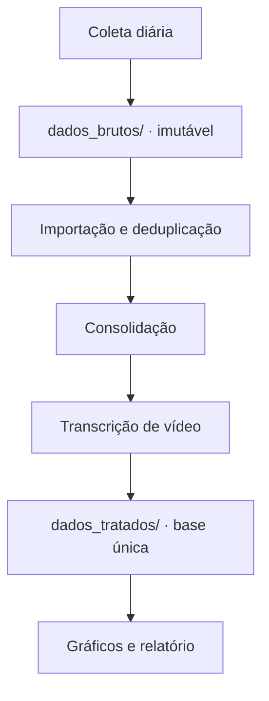

# 03 · Pipeline de dados de pesquisa

Pipeline que sustenta uma pesquisa acadêmica de comunicação política — bolsa ProIC/FAPDF, no IDP —
sobre o comportamento de candidatos à presidência no Instagram em 2026.

Cerca de 20 scripts em Python, da coleta diária ao gráfico que entra no relatório.

---

## O fluxo

| Etapa | O que faz |
|---|---|
| **Coleta** | Captura do feed e dos Reels, com pausa aleatória entre ações; contagem diária de seguidores, uma linha por dia |
| **Importação** | Converte a captura bruta para a base, sem sobrescrever o que já existe |
| **Consolidação** | Unifica as importações numa base única por período |
| **Transcrição** | Todo vídeo que entra na base é transcrito, para análise de discurso |
| **Visualização** | Seis geradores de gráfico (dispersão, interações por dia, por semana, por período, médias semanais, panorama) e um relatório narrativo |

---

## As decisões de desenho

### Bruto imutável

`dados_brutos/` nunca é editado. Toda saída vai para `dados_tratados/`. Qualquer número do relatório
é reproduzível a partir do bruto, e um erro de tratamento nunca destrói semanas de coleta.

### Importação idempotente

A coleta é diária e sobrepõe períodos. A importação precisa poder rodar duas vezes sem duplicar
post. A deduplicação é parte do pipeline, não um passo manual.

### Lacuna registrada é lacuna conhecida

Onde o dado não existe, isso fica escrito junto da análise: posts excluídos pelo perfil, métricas que
não aparecem em conteúdo de contas parceiras, candidatos que saíram no primeiro turno. Pesquisa sem
registro de lacuna vira conclusão errada.

### LGPD como critério de coleta

Comentários foram deixados fora da coleta por decisão de orientação, justamente por envolver dado de
pessoa comum. O recorte é conteúdo público de figura pública.

---

## Por que o código não está aqui

Os scripts de coleta operam sobre uma plataforma de terceiro e o dataset é de pesquisa em andamento,
com regras próprias de uso. Publicar a ferramenta de raspagem funcionando não seria adequado, e os
dados não são meus para distribuir.

O que dá para avaliar sem isso é o que importa: como o pipeline foi desenhado, e por quê.

---

## Stack

Python · automação de navegador · API de coleta · transcrição de áudio · pandas · matplotlib · Excel
