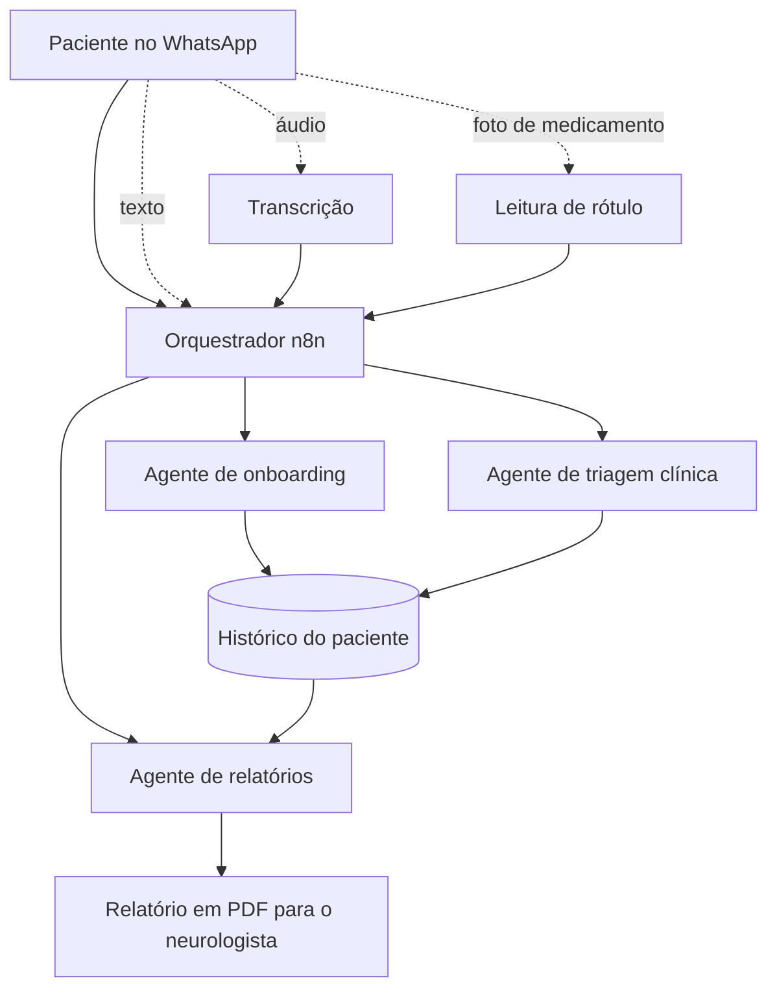

# 04 · Sem Crise AI

MVP de saúde digital para quem tem enxaqueca crônica. Transforma o "diário de dor" — que o paciente
precisa preencher todo dia e quase ninguém mantém — numa conversa no WhatsApp.

Desenvolvido entre agosto e novembro de 2025.

---

## O problema

O tratamento de enxaqueca depende de registro: o que disparou a crise, quanto durou, o que foi
tomado. O método padrão é um diário em papel ou app. O abandono é alto, e sem registro o neurologista
decide no escuro.

A hipótese: o problema não é o paciente, é a interface. Ninguém abre um app no meio de uma crise de
dor de cabeça — mas quase todo mundo responde uma mensagem.

---

## Arquitetura

### Orquestrador

Um fluxo em n8n recebe toda mensagem e decide qual subagente responde, conforme o estado do
paciente. Paciente novo cai no onboarding; paciente ativo relatando crise cai na triagem; pedido de
relatório cai no gerador.

### Entrada multimodal

| Entrada | Tratamento |
|---|---|
| Texto | Direto para o agente |
| Áudio | Transcrição antes do agente — quem está com dor prefere falar |
| Imagem | Leitura de rótulo de medicamento ou de alimento |

### Inteligência sobre o histórico

Com o registro acumulado, o sistema procura padrão entre as variáveis que o paciente relata — sono,
estresse, alimentação — e a frequência das crises. O valor não está no registro isolado, está na
correlação que ninguém enxerga lendo o próprio diário.

### Saída que serve ao médico

O paciente pede o relatório e recebe um PDF estruturado para levar à consulta. É esse artefato que
fecha o ciclo: o registro vira decisão clínica.

---

## O que eu aprendi

**O canal é parte do produto.** A mesma funcionalidade num app próprio teria o mesmo abandono do
diário de papel. Ir para onde o usuário já está foi a decisão de produto que mais importou.

**Multiagente serve para separar responsabilidade, não para impressionar.** Onboarding, triagem e
relatório têm objetivos e tons diferentes. Um prompt único tentando fazer os três fica pior nos três.

**Saúde exige limite explícito.** O sistema registra e organiza; não diagnostica nem sugere conduta.
Isso fica escrito no comportamento dos agentes, não só na tela.

---

## Stack

n8n · LLMs · API do WhatsApp · transcrição de áudio · visão para leitura de rótulo · geração de PDF
